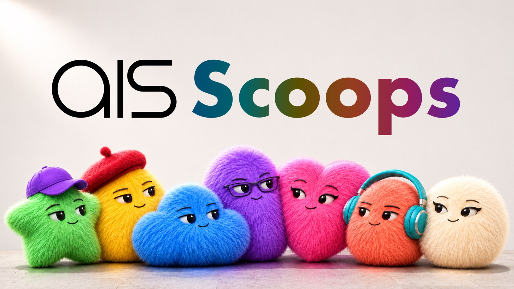
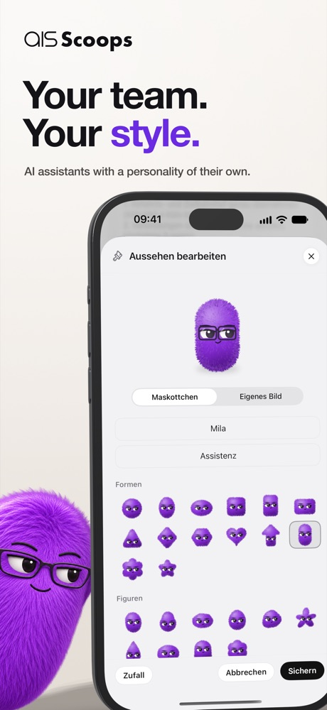
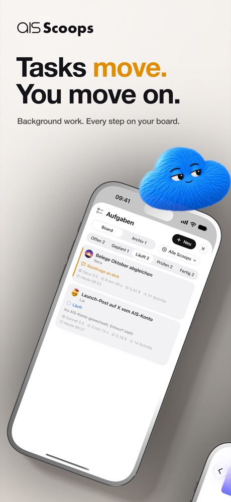
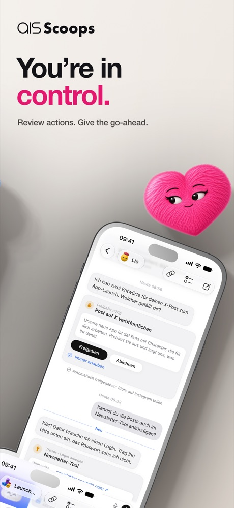
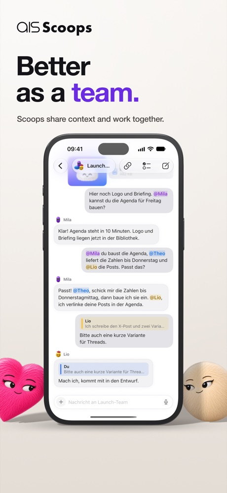
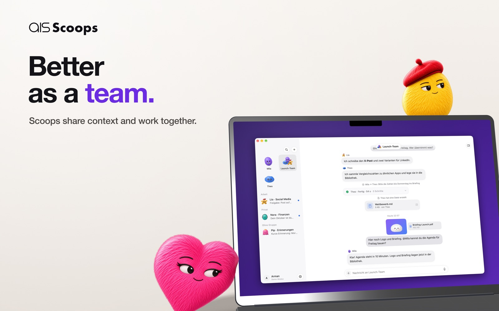
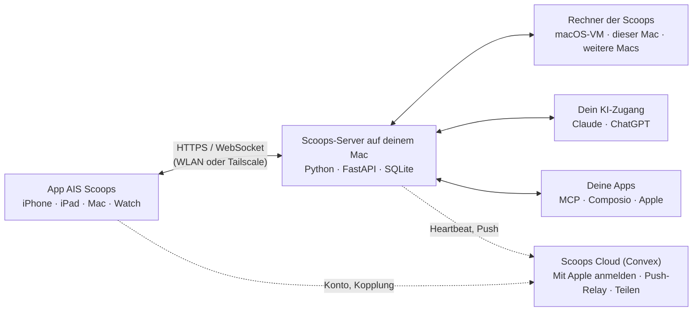
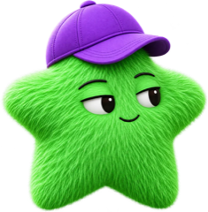
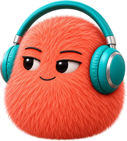

<div align="center">

<picture>
  <source media="(prefers-color-scheme: dark)" srcset=".github/assets/hero-dark.jpg">
  
</picture>

<h3>Dein Team aus KI-Assistenten. Jeder mit eigenem Kopf.</h3>

<p>
Scoops sind persönliche KI-Agenten, die auf <b>deinem eigenen Mac</b> wohnen.<br>
Sie chatten wie Kollegen, erledigen Aufgaben im Hintergrund, nutzen deine Apps und deinen Rechner –<br>
und fragen dich, bevor etwas nach außen geht.
</p>

<p>
<a href="LICENSE"></a>


</p>

<p>
<a href="https://apps.apple.com/app/id6833654924"><b>App Store</b></a> ·
<a href="https://github.com/SPRTCS/ais-scoops-server/releases/latest"><b>Server für Mac</b></a> ·
<a href="https://ais-con.com/scoops"><b>Website</b></a> ·
<a href="#-loslegen"><b>Loslegen</b></a> ·
<a href="#-aufbau"><b>Aufbau</b></a> ·
<a href="CONTRIBUTING.md"><b>Mitmachen</b></a> ·
<a href="README.md"><b>English</b></a>
</p>

</div>

<br>

<table>
<tr>
<td width="25%"></td>
<td width="25%"></td>
<td width="25%"></td>
<td width="25%"></td>
</tr>
</table>

## Nicht ein Assistent. Ein ganzes Team.

Die meisten KI-Apps geben dir ein Chatfenster. **Scoops gibt dir ein Team.** Jeder Scoop hat einen Namen, ein
Gesicht, einen Charakter und ein eigenes Gedächtnis. Gib ihm eine Rolle (Assistenz, Social Media, Finanzen,
Recherche), und er lernt, wie du arbeitest. Im Gruppenchat verteilen Scoops die Arbeit untereinander, übergeben
Ergebnisse und legen alles in einer gemeinsamen Bibliothek ab.

Das Wichtigste: **Scoops laufen auf deiner Hardware.** Der Server wohnt auf deinem Mac, Chats und Dateien bleiben
dort, und den KI-Zugang bringst du selbst mit: dein **Claude- oder ChatGPT-Abo** oder einen API-Schlüssel. Es gibt
kein gehostetes „KI-Backend“, das deine Gespräche sieht.

| | |
|---|---|
| 💬 **Chatten mit Persönlichkeit** | Form, Farbe, Charakter, Regeln. Scoops merken sich Vorlieben, Personen und Projekte über Gespräche hinweg. |
| 🗂️ **Aufgaben im Hintergrund** | Größere Aufträge laufen wie bei einem Coding-Agenten auf einem eigenen Board (*Offen → Geplant → Läuft → Prüfen → Fertig*). Die Ergebnisse landen in der Bibliothek. |
| 🖥️ **Echte Arbeit am Rechner** | Shell, Datei-Werkzeuge und **Computer Use**: auf dem Server-Mac, in einer macOS-VM oder auf weiteren Macs. Live zusehen und jederzeit übernehmen. |
| ✅ **Du behältst die Kontrolle** | Mails, Posts, Käufe, Anrufe und riskante Befehle erscheinen als **Freigabe-Karte**: einmal freigeben, ablehnen oder dauerhaft erlauben. |
| 🔌 **Deine Apps** | Gmail, Notion, Kalender und mehr über Composio, **beliebige MCP-Server** (auch mit OAuth), Apple-Erinnerungen, Kalender, Kontakte und Home. Passwörter liegen in einem Tresor, den die Scoops nie sehen. |
| ⏰ **Routinen** | Morgenbriefing, Wochenrückblick, Postfach-Check: wiederkehrende Aufträge nach Zeitplan. |
| 👥 **Teams und Teilen** | Gruppenchats, ein Haupt-Scoop mit Überblick, der die anderen verbessern kann, und geteilte Scoops für Partner, Familie oder Team. |
| 🎙️ **Überall dabei** | Native Apps für **iPhone, iPad, Mac und Apple Watch**, Widgets, Sperrbildschirm-Widgets, Live-Aktivitäten, Push und **Sprechmodus**. |

<div align="center">

</div>

## 🚀 Loslegen

### Nutzen (etwa 10 Minuten, ohne Terminal)

1. **AIS Scoops** aus dem [App Store](https://apps.apple.com/app/id6833654924) auf iPhone, iPad oder Mac laden.
2. **AIS Scoops Server** aus dem [neuesten Release](https://github.com/SPRTCS/ais-scoops-server/releases/latest) laden
   und in *Programme* ziehen. Du brauchst einen Mac mit Apple-Chip und macOS 26 oder neuer.
3. Der Einrichtungsassistent zeigt einen Kopplungscode. Gib ihn in der App unter *Deine Server → Server hinzufügen* ein.
4. KI verbinden: mit deinem **Claude**- (Pro/Max) oder **ChatGPT**-Abo (Plus/Pro) anmelden oder einen API-Schlüssel
   eintragen.
5. Den ersten Scoop schlüpfen lassen. 🐣

Die ausführliche Anleitung steht in [docs/installation.md](docs/installation.md).

### Selbst bauen

```sh
# Server (Python 3.12, uv)
cd Server && uv sync
AISBOT_EDITION=standard AISBOT_HOME="$PWD/.dev" uv run aisbot serve   # http://127.0.0.1:8787
bin/test                                                                # alle Tests, ohne Netz und Schlüssel

# Apps (Xcode 26, XcodeGen)
cd App && xcodegen generate && open AISBot.xcodeproj                     # Startargument -mock: Demo ohne Server

# Cloud (Convex)
cd Cloud && npm install && npm test
```

## 🧭 Aufbau



- **Chats, Gedächtnis, Dateien und Schlüssel bleiben auf deinem Mac.** Die Cloud kennt nur dein Konto, deine Server
  und mit wem du einen Scoop teilst. Push-Nachrichten leitet sie weiter, ohne den Inhalt zu sehen.
- **Abos auf dem offiziellen Weg.** Mit Claude- und ChatGPT-Abos steuert der Server die unveränderten offiziellen
  Programme Claude Code und Codex. Du meldest dich dort selbst an, Scoops liest nie deren Tokens
  ([Details](docs/abos.md)).
- **Leitplanken im Code.** Freigabe-Karten, Rechte-Modus pro Scoop, Tresor, Ausgabenlimits und Aufsicht setzt der
  Server durch, und Tests prüfen sie.

| Ordner | Inhalt |
|---|---|
| [`App/`](App) | Apps für iPhone, iPad, Mac und Watch, Widgets, Live-Aktivitäten und die Server-App *AIS Scoops Server* (SwiftUI) |
| [`Server/`](Server) | Der Scoops-Server: Agenten, Gedächtnis, Aufgaben, Routinen, Freigaben, Werkzeuge (Python) |
| [`Cloud/`](Cloud) | Konten, Kopplungscodes, Server-Verzeichnis, Push-Relay, Teilen (Convex) |
| [`docs/`](docs) | Konzepte, API-Vertrag und Funktionsbeschreibungen |

## 🤝 Mitmachen

Jeder Beitrag hilft: Fehlerberichte, Doku, Übersetzungen und Funktionen. Los geht es in
[CONTRIBUTING.md](CONTRIBUTING.md). Besonders gesucht: eine **englische Oberfläche** (String Catalog) und englische
Fassungen der Doku. Sicherheitslücken bitte nicht öffentlich melden, sondern wie in [SECURITY.md](SECURITY.md)
beschrieben.

## 📄 Lizenz

Der Quellcode steht unter der [Apache-Lizenz 2.0](LICENSE). Der Name **AIS Scoops**, das AIS-Logo, die
Scoop-Figuren und die Marketing-Bilder sind davon ausgenommen, siehe [TRADEMARKS.md](TRADEMARKS.md).

<br>

<div align="center">






<sub>Mit ❤️ gemacht in Deutschland von <a href="https://ais-con.com">AIS</a> und den Scoops.</sub>
</div>
