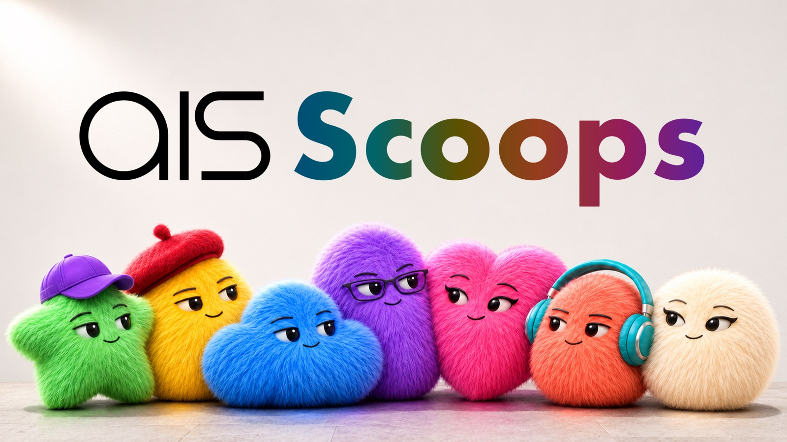
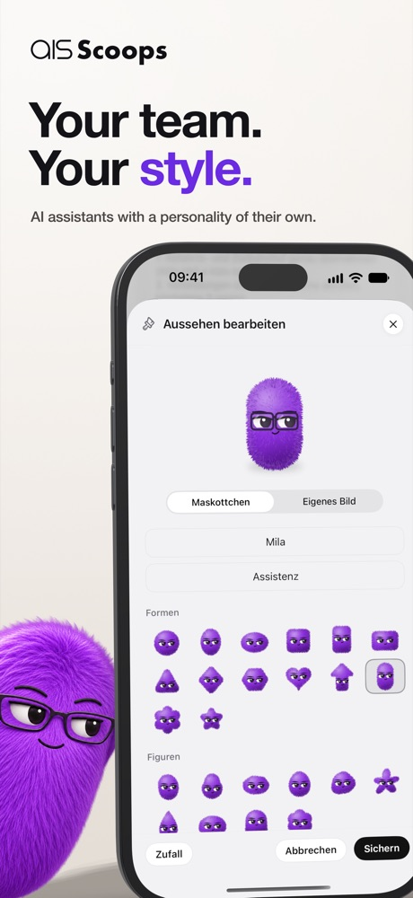
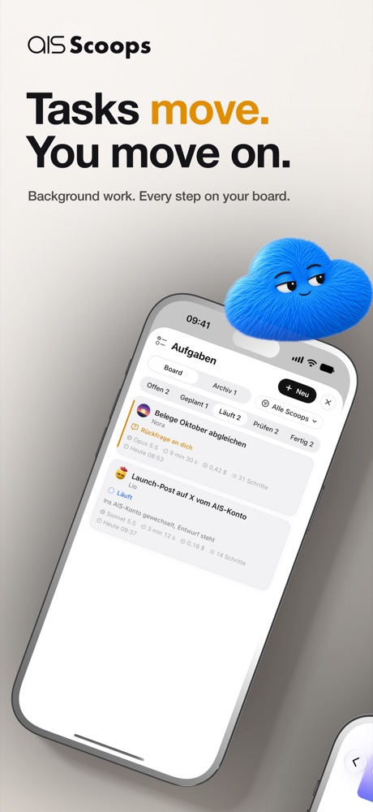
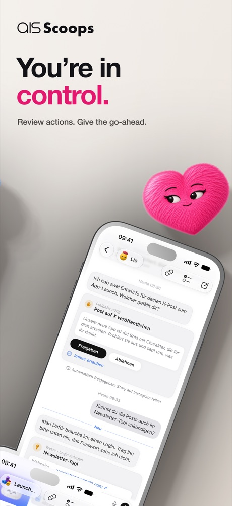
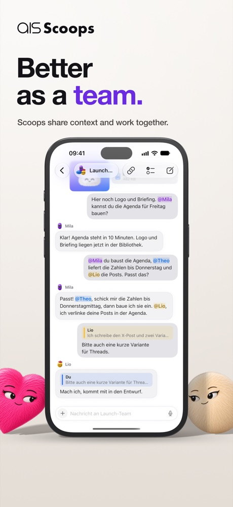
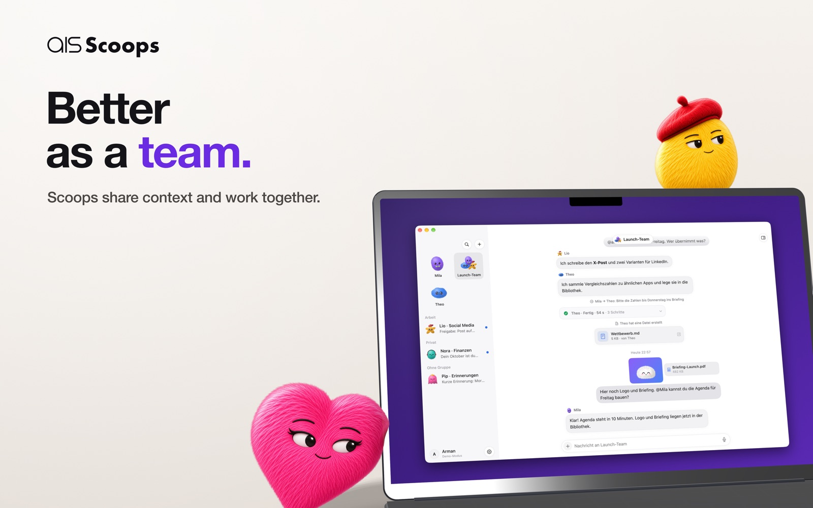
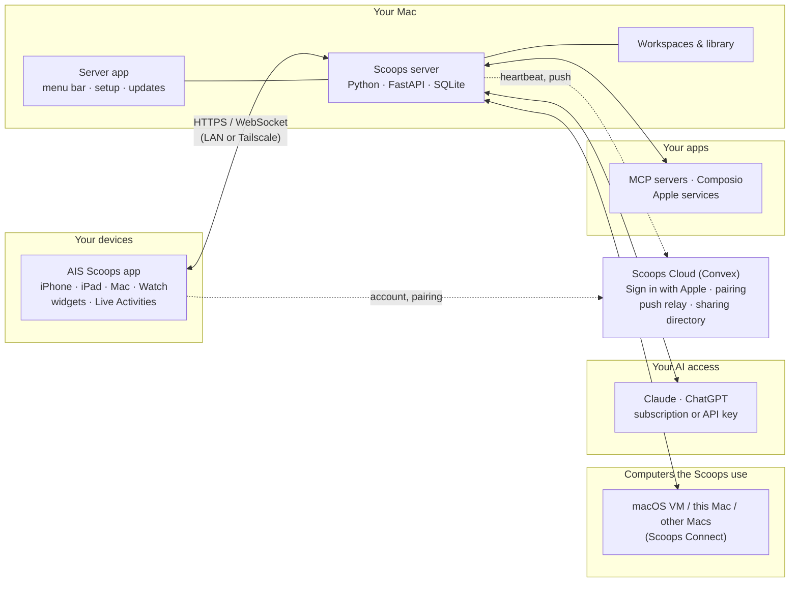

<div align="center">

<picture>
  <source media="(prefers-color-scheme: dark)" srcset=".github/assets/hero-dark.jpg">
  
</picture>

<h3>Your team of AI assistants. Each with a mind of its own.</h3>

<p>
Scoops are personal AI agents that live on <b>your own Mac</b>.<br>
They chat like colleagues, work through tasks in the background, use your apps and your computer –<br>
and ask for your approval before anything leaves the house.
</p>

<p>
<a href="https://github.com/SPRTCS/scoops/actions/workflows/ci.yml"></a>
<a href="LICENSE"></a>


</p>

<p>
<a href="https://apps.apple.com/app/id6833654924"><b>App Store</b></a> ·
<a href="https://github.com/SPRTCS/ais-scoops-server/releases/latest"><b>Server for Mac</b></a> ·
<a href="https://ais-con.com/en/scoops"><b>Website</b></a> ·
<a href="#-quick-start"><b>Quick start</b></a> ·
<a href="#-architecture"><b>Architecture</b></a> ·
<a href="CONTRIBUTING.md"><b>Contribute</b></a> ·
<a href="README.de.md"><b>Deutsch</b></a>
</p>

</div>

<br>

<table>
<tr>
<td width="25%"></td>
<td width="25%"></td>
<td width="25%"></td>
<td width="25%"></td>
</tr>
</table>

## Not one assistant. A whole team.

Most AI apps give you one chat window. **Scoops gives you a team.** Every Scoop has a name, a face, a personality
and a memory of its own. Give one a role (assistant, social media, finance, research), and it learns how you work.
Put a few of them in a group chat, and they split the work, hand over results and share one library.

The important part: **Scoops run on your hardware.** The server lives on your Mac, your chats and files stay there,
and you bring your own AI access, either your **Claude or ChatGPT subscription** or an API key. There is no hosted
"AI backend" that sees your conversations.

<table>
<tr>
<td width="50%" valign="top">

### 💬 Chat with personality
Shape, color, character, rules. Scoops remember preferences, people and projects across conversations, react with
emoji, and answer like a colleague, not like a form.

### 🗂️ Background tasks
Hand off bigger jobs ("research this", "clean up these receipts"). They run like a coding agent on their own board
(*Open → Scheduled → Running → Review → Done*) and drop the results into your library.

### 🖥️ Real work on a real computer
Scoops get a persistent shell, file tools and **computer use**: they can operate apps on the server Mac, in a macOS
VM, or on other Macs you connect. Watch live and take over any time.

### ✅ You stay in control
Anything that leaves the house (mails, posts, purchases, calls, risky shell commands) shows up as an **approval card**.
Approve once, decline, or allow a kind of action permanently. Every step stays visible.

</td>
<td width="50%" valign="top">

### 🔌 Your apps, your tools
Connect Gmail, Notion, calendars and more via Composio, add **any MCP server** (OAuth included), and use Apple
Reminders, Calendar, Contacts and Home. Passwords go into a vault the Scoops never see.

### ⏰ Routines
Morning briefing, weekly review, inbox check: recurring jobs on a schedule, with check times and the board as a
paper trail.

### 👥 Teams and sharing
Group chats with several Scoops, a main Scoop that keeps the overview and can coach the others, and shared Scoops
for your partner, family or team, each with their own role.

### 🎙️ Everywhere you are
Native SwiftUI apps for **iPhone, iPad, Mac and Apple Watch**, plus widgets, lock-screen widgets, Live Activities,
push notifications and a hands-free **voice mode**.

</td>
</tr>
</table>

<div align="center">

</div>

## 🚀 Quick start

### Use it (about 10 minutes, no terminal)

1. Install **AIS Scoops** from the [App Store](https://apps.apple.com/app/id6833654924) on your iPhone, iPad or Mac.
2. Download **AIS Scoops Server** from the [latest release](https://github.com/SPRTCS/ais-scoops-server/releases/latest)
   and drag it into *Applications*. You need a Mac with Apple silicon and macOS 26 or newer.
3. The setup assistant shows a pairing code. Enter it in the app under *Your servers → Add server*.
4. Connect an AI: sign in with your **Claude** (Pro/Max) or **ChatGPT** (Plus/Pro) subscription, or paste an API key.
5. Hatch your first Scoop. 🐣

Want to use your Scoops on the go? Turn on Tailscale in the server app. The full guide (in German) is in
[docs/installation.md](docs/installation.md).

### Build it from source

<details>
<summary><b>Server</b> (Python 3.12, <a href="https://docs.astral.sh/uv/">uv</a>)</summary>

```sh
cd Server
uv sync
AISBOT_EDITION=standard AISBOT_HOME="$PWD/.dev" uv run aisbot serve   # http://127.0.0.1:8787
bin/test                                                                # full test suite, no network, no keys
```

`AISBOT_EDITION=standard` is what the Mac server app uses. Without it you get the maintainer's personal edition with
extra integrations. See [Server/README.md](Server/README.md) for all settings.
</details>

<details>
<summary><b>Apps</b> (Xcode 26, <a href="https://github.com/yonaskolb/XcodeGen">XcodeGen</a>)</summary>

```sh
cd App
xcodegen generate
open AISBot.xcodeproj
```

Set your own development team and bundle IDs in `project.yml` before running on a device. To explore the UI
without any server, start the app with the launch argument `-mock`: you get demo Scoops, a running task, approval
cards and simulated replies.
</details>

<details>
<summary><b>Cloud</b> (accounts, pairing and push relay on <a href="https://convex.dev">Convex</a>)</summary>

```sh
cd Cloud
npm install
npm test            # vitest, runs fully offline
npx convex dev      # your own deployment
```

Point the app at your deployment with the launch argument `-cloudurl https://<deployment>.convex.cloud` and the
server with `cloud_url` in its `config.json`.
</details>

## 🧭 Architecture



- **Chats, memory, files and keys stay on your Mac.** The cloud only knows who you are, which servers you own and who
  you shared a Scoop with. It relays push notifications without seeing their content.
- **Subscriptions are used the official way.** For Claude and ChatGPT plans, the server drives the unmodified
  official Claude Code and Codex programs, and you sign in to them yourself. Scoops never read or store their tokens
  ([details](docs/abos.md)).
- **Guardrails are code, not vibes.** Approval cards, permission modes per Scoop, a vault the model never sees, spend
  limits and an oversight role are enforced on the server and covered by tests.

## 📦 What's in this repo

| Path | What it is | Stack |
|---|---|---|
| [`App/AISBot`](App/AISBot) | The app for iPhone, iPad and Mac | SwiftUI, Swift 6 |
| [`App/AISBotWatch`](App/AISBotWatch) | Apple Watch app and complications | SwiftUI, WidgetKit |
| [`App/AISBotWidgets`](App/AISBotWidgets) | Widgets, lock-screen widgets, Live Activities | WidgetKit, ActivityKit |
| [`App/ScoopsConnect`](App/ScoopsConnect) | *AIS Scoops Server* for Mac: runs the server, setup assistant, computer access, auto-updates | SwiftUI, AppKit, Sparkle |
| [`Server`](Server) | The Scoops server: agents, memory, tasks, routines, approvals, tools | Python 3.12, FastAPI, Claude Agent SDK, Codex SDK |
| [`Cloud`](Cloud) | Accounts, pairing codes, server directory, push relay, sharing | Convex, TypeScript |
| [`docs`](docs) | Concepts, API contract and feature docs (German) | Markdown |

Around 60k lines of Swift, 25k lines of Python and 30+ test suites for the server alone.

## 🗺️ Roadmap and good first issues

- 🌍 **English UI.** The app and the Scoops speak German today. Moving strings into a String Catalog and translating
  them is the most valuable contribution right now.
- 📖 **English docs.** The feature docs in `docs/` are German. Translations are very welcome.
- 🐧 **Linux server.** The server core is plain Python. macOS-specific parts (keychain, macOS VMs, Apple services)
  would need small adapters.
- 🧩 **More connectors and skills.** New MCP presets, routines and Scoop templates.

Have an idea? Open a [discussion](../../discussions) or an [issue](../../issues/new/choose).

## 🤝 Contributing

Contributions of every size are welcome: bug reports, docs, translations, features. Start with
[CONTRIBUTING.md](CONTRIBUTING.md). Please also read the [Code of Conduct](CODE_OF_CONDUCT.md). Found a security
problem? Please don't open an issue; follow [SECURITY.md](SECURITY.md) instead.

## 📄 License

The source code is licensed under the [Apache License 2.0](LICENSE).

The name **AIS Scoops**, the AIS logo, the Scoop characters and the marketing artwork are **not** covered by that
license. See [TRADEMARKS.md](TRADEMARKS.md) for what that means for forks.

<br>

<div align="center">


<sub>Made with ❤️ in Germany by <a href="https://ais-con.com">AIS</a> and the Scoops.</sub>
</div>
